# Backend preparado para clientes web y móviles

Esta rama introduce una API v1. No crea una app móvil, no despliega servicios y no modifica el corpus, el esquema de `fragmentos` ni los embeddings. El cliente normal envía una sola operación; la selección RAG y los datos de conversación se resuelven en el servidor.

## Flujo y módulos

```mermaid
flowchart LR
  Cliente[Web o futuro cliente móvil] --> HTTP[POST /api/v1/consultas]
  HTTP --> Identidad[Identidad verificada o desarrollo explícito]
  Identidad --> Control[Reserva de cuota e idempotencia en PostgreSQL]
  Control --> Consulta[Caso de uso de consulta]
  Consulta --> RAG[Detección y reformulación si corresponde]
  RAG --> Ollama[Ollama: bge-m3]
  Ollama --> PG[Recuperación en PostgreSQL / pgvector]
  PG --> Seleccion[Selección de secciones y fragmentos]
  Seleccion --> LLM[Generación OpenAI cuando hay contexto]
  LLM --> Uso[Registro de tokens, modelo, duración y resultado]
  Uso --> Cliente
```



| Ubicación | Responsabilidad |
| --- | --- |
| `servidor-web.mjs` | Composición de dependencias, migración aditiva y arranque. |
| `web-handler.mjs`, `backend/http/consultas.mjs` | HTTP, Origin, JSON/NDJSON y archivos de React; sin SQL ni selección RAG. |
| `backend/aplicacion/consultar.mjs` | Coordinar la consulta y el diagnóstico; reservar cuota y deduplicar; registrar llamadas. |
| `backend/aplicacion/identidad.mjs` | Puerto `autenticar(req) -> { id }` para un proveedor real. |
| `backend/rag/servicio.mjs` | Etapas reutilizables del RAG y validación de la selección. |
| `backend/infraestructura/` | Repositorios PostgreSQL, chat OpenAI/Gemini, Ollama y migración de control. |
| Módulos RAG de la raíz | Algoritmos existentes: `detectar-juego`, `conversacion`, `reformular-consulta`, `seleccionar-contexto`, `contexto-respuesta`, `buscar`, etc. |
| `api.mjs` | Fachada compatible con los programas de consola (`embedding`, `embeddingsEnLote`, `responder`, contador `pedidos`). |

Sin framework HTTP ni dependencias nuevas. La implementación en memoria de control está destinada exclusivamente a pruebas con proveedores simulados. El servidor real inyecta siempre el control PostgreSQL.

## Contrato público v1

`POST /api/v1/consultas`

Encabezados:

```http
Content-Type: application/json
Accept: application/json
Idempotency-Key: 62bf70c1-8d6e-46e4-af88-114fd155a38e
```

La clave es obligatoria: 8–100 letras ASCII, dígitos, guiones o guiones bajos. Se recomienda un UUID aleatorio nuevo por operación lógica; conservarlo al reintentar esa misma operación. No es una credencial de usuario.

Primera pregunta:

```json
{"pregunta":"¿Cuánto vale cantar truco en El Truco?"}
```

Seguimiento:

```json
{
  "pregunta":"¿Y si no quiero?",
  "consultaAnteriorId":"11111111-1111-4111-8111-111111111111"
}
```

`pregunta`: texto de 1–1000 caracteres tras recortar espacios. `consultaAnteriorId`: UUID opcional de una consulta pública anterior terminada con HTTP 200, perteneciente al mismo usuario verificado. Se omite para una conversación nueva. No se envían respuestas anteriores inventadas por el cliente: el servidor obtiene el último intercambio guardado y limita su respuesta a 4000 caracteres, como antes. Si se menciona explícitamente otro juego, conserva la detección actual y descarta el contexto del juego anterior.

Son los únicos campos aceptados. `userId`, `contexto`, `prompt`, `modelo`, `ids`, `k`, `umbral`, `preguntaResuelta` y otros campos producen HTTP 400. `RAG_K`, `UMBRAL`, el modo de selección por secciones y el modelo pertenecen al servidor.

Respuesta HTTP 200 de ejemplo:

```json
{
  "id":"11111111-1111-4111-8111-111111111111",
  "estado":"respondida",
  "juego":"El Truco",
  "baraja":"espanola",
  "respuesta":"El truco aceptado vale dos puntos.",
  "modeloInvocado":true,
  "fuentes":[
    {
      "id":290,
      "juego":"El Truco",
      "seccion":"Truco",
      "origen":"https://www.nhfournier.es/como-jugar/truco/",
      "texto":"Fragmento exacto seleccionado del corpus."
    }
  ]
}
```

El ID del fragmento y su texto en este ejemplo son ilustrativos; los reales salen de SQL. `baraja` es `espanola`, `inglesa-francesa` o `general`, según los metadatos revisados del juego. Las fuentes conservan solo `id`, `juego`, `seccion`, `origen` y `texto`; nunca las construye el LLM. Son los fragmentos enviados como contexto, no una afirmación de que cada uno fue citado expresamente por el modelo.

Abstención: mismo contrato, `estado: "abstencion"`, texto `No lo encuentro en los documentos.` y `fuentes: []`. `modeloInvocado` indica si hubo una llamada al modelo de chat, incluyendo una posible reformulación. Si ningún candidato supera el corte, no se invoca al generador; en un seguimiento pudo haber sido necesaria la interpretación previa.

`GET /api/juegos` sigue disponible para cargar la lista y las capacidades. Añade `apiVersion: 1`, `diagnosticosHabilitados` y `autenticacion`. No habilita al cliente a elegir parámetros del RAG.

### Progreso en la misma operación

Con `Accept: application/x-ndjson`, el cuerpo contiene un objeto JSON por línea:

```jsonl
{"tipo":"juego","juego":"El Truco","baraja":"espanola"}
{"tipo":"etapa","estado":"busqueda"}
{"tipo":"etapa","estado":"generacion"}
{"tipo":"resultado","consulta":{"id":"11111111-1111-4111-8111-111111111111","estado":"respondida","juego":"El Truco","baraja":"espanola","respuesta":"Dos puntos.","modeloInvocado":true,"fuentes":[]}}
```

El ejemplo abrevia las fuentes. Puede aparecer `estado: "reformulacion"` antes de la búsqueda. Son avisos de progreso de una sola petición, no instrucciones para que el cliente ejecute las etapas. React los usa para las animaciones del gaucho, incluyendo el cambio de mazo antes de pensar. Con movimiento reducido se mantienen las poses estáticas existentes.

Si ya empezó el stream, HTTP sigue siendo 200 y un fallo termina con `{"tipo":"error","error":"...","codigo":"...","estadoHttp":502,"consultaId":"..."}`. Antes de empezar el stream se usa el error JSON y HTTP correspondiente. Una respuesta idempotente ya guardada puede devolver solamente la línea `resultado`. El cliente debe recibir `resultado` o `error`; un corte sin ellos se reintenta con la misma clave.

### Errores JSON

```json
{"error":"Se agotó la cuota diaria de consultas de este usuario.","codigo":"CUOTA_AGOTADA"}
```

| HTTP | Casos principales |
| --- | --- |
| 400 | Cuerpo/campos/clave inválidos. |
| 401 | Autenticador real no valida la sesión. |
| 403 | Origin no permitido. |
| 404 | Consulta anterior inaccesible o ruta de diagnóstico deshabilitada. |
| 409 | `CLAVE_REUTILIZADA` con otro contenido; `CONSULTA_EN_CURSO` con la misma operación pendiente. |
| 422 | No se identifica un juego o se mencionan varios. |
| 429 | Cuota local agotada (`CUOTA_AGOTADA`). |
| 502/503 | Fallo de chat, datos, embeddings o registro. Los detalles y las credenciales del proveedor no se devuelven. |

Una operación que ya reservó cuota añade `consultaId` al error persistido. Errores de validación/autenticación anteriores a la reserva no tienen por qué incluirlo.

## Identidad, cuotas y reintentos

- **Desarrollo y demo:** `AUTH_MODE=desarrollo` usa la identidad fija `desarrollo-local`, visible en el aviso de arranque. Todos los visitantes comparten esa cuota y no son cuentas privadas. No usar datos personales ni considerarlo autenticación. Se mantiene por compatibilidad cuando `NODE_ENV` no es producción y no se configuró `AUTH_MODE`; declararlo explícitamente en `.env` es lo recomendado y en Compose ya está declarado.
- **Producción:** `NODE_ENV=production` exige `AUTH_MODE=externa`. Sin integrar `autenticar(req)` el servidor rechaza el arranque, antes de abrir el puerto. El adaptador deberá verificar el token del proveedor (firma, emisor, audiencia, expiración y revocación según corresponda). Ni el cuerpo ni `X-User-Id` identifican usuarios. No se incluye un token fijo que simule autenticación real.
- La unidad actual de cuota es una **operación aceptada**, no dólares ni tokens. Se reserva antes de llamar a Ollama o al chat. Una abstención o fallo tras reservar conserva esa unidad. La política comercial de liberaciones/reembolsos queda pendiente.
- Por defecto hay 50 operaciones públicas/día UTC/usuario y 200 operaciones de diagnóstico/día UTC/usuario. El diagnóstico consume su propio ámbito y nunca descuenta de la cuota pública. Los valores son configuración del servidor, no límites comerciales definitivos.
- En PostgreSQL, reserva de cuota e inserción de consulta se hacen en una transacción, con bloqueo asesor por usuario/ámbito y unicidad de `(usuario_id, ambito, clave)`. Esto cubre solicitudes simultáneas entre procesos e instancias, y persiste al reiniciar.
- Misma clave + misma entrada: se devuelve el resultado o error guardado sin nuevos embeddings ni llamadas de chat. No se descuenta otra cuota, incluso al cambiar de día. Misma clave + otra entrada: 409. Una operación todavía procesando da 409 y no se inicia de nuevo.
- La desconexión del cliente no cancela deliberadamente el procesamiento en curso. React conserva clave y cuerpo al reintentar desde la misma página; cambiar la pregunta o iniciar una conversación nueva crea otra operación. Un cliente móvil deberá persistir su clave/cuerpo si quiere reintentar tras cerrar la app.
- Los errores terminales también se guardan. Enter comprueba el resultado de la misma operación, incluso si terminó con error; para una tentativa realmente nueva hay que usar otra clave (en la web, nueva pregunta o nueva conversación), que consume otra cuota.
- Si el proceso cae después de una llamada al proveedor y antes de guardar su resultado, la reserva queda pendiente y **no se reejecuta automáticamente**. No se promete exactamente una ejecución remota: sin una garantía del proveedor, un timeout puede tener costo desconocido. Se prioriza evitar el doble gasto. Falta una herramienta operativa de reconciliación para esos casos.

## Registro de uso y costo

El arranque crea, de forma aditiva, `rag_consultas`, `rag_cuotas_diarias` y `rag_llamadas` mediante `backend/infraestructura/control.sql`. No ejecuta `esquema.sql`, no trunca `fragmentos` y no reindexa. El rol del entorno de demo necesita permiso para crear esas tablas e índices. En producción deberá aplicarse la migración con un rol separado.

Cada consulta conserva usuario verificado, ámbito, entrada necesaria para continuidad, estado, salida/error, duración y fechas. Cada intento de chat conserva consulta, etapa, proveedor, modelo informado, intento, resultado, tokens de entrada/salida/caché, metadatos `usage` originales, duración y costo estimado si puede calcularlo. Se registra la intención **antes** de enviar la llamada; si ese registro falla, no se llama al proveedor. Las actualizaciones usan el mismo ID de llamada para no sumar dos veces un intento.

La API de OpenAI informa `usage.prompt_tokens`, `completion_tokens` y detalles de caché; `completion_tokens` ya incluye los tokens de razonamiento que correspondan. No se vuelven a sumar. [Contrato oficial de Chat Completions](https://developers.openai.com/api/reference/resources/chat/subresources/completions/methods/create).

`TARIFAS_MODELOS_JSON` permite inyectar tarifas por nombre exacto de modelo informado. Cada entrada exige `moneda`, `entradaPorMillon`, `salidaPorMillon` y `entradaCachePorMillon`; opcionalmente `escrituraCachePorMillon`. La fórmula diferencia entrada ordinaria, lectura de caché, escritura de caché y salida. Si falta el uso, el modelo no tiene tarifa, o hay escritura de caché sin su tarifa, el costo es `null`: no se inventa un cero. `{}` conserva métricas reales sin estimar precios. Las tarifas no están en código de negocio y no se consultan en Internet durante una petición.

Los rechazos 429 del proveedor mantienen el máximo previo de cuatro intentos (esperas 10/20/30 segundos), cada uno registrado. Errores de transporte, timeouts y 5xx no se reintentan automáticamente. El mismo reintento HTTP del cliente usa la clave guardada. Se conserva el contador de pedidos de consola, pero la contabilización durable corresponde a las llamadas de la API, no a scripts de evaluación ejecutados manualmente.

Consulta administrativa de ejemplo, sin publicar estas tablas como API:

```sql
SELECT c.id, c.usuario_id, c.ambito, c.estado, c.http_estado,
       c.duracion_ms, l.etapa, l.modelo, l.resultado,
       l.entrada_tokens, l.salida_tokens, l.costo_estimado, l.moneda
FROM rag_consultas c
LEFT JOIN rag_llamadas l ON l.consulta_id = c.id
ORDER BY c.creada_en DESC, l.creada_en;
```

No se guardan claves ni prompts completos en el registro de llamadas. Sí se guardan preguntas y respuestas para continuidad/idempotencia: decidir retención, acceso administrativo, borrado y privacidad antes de producción. Una fila de llamada `iniciada` después de una caída significa uso incierto, no costo cero.

## Diagnóstico restringido

Rutas de desarrollo: `POST /api/diagnostico/{detectar,reformular,recuperar,responder}`. Los alias históricos `/api/{detectar,reformular,recuperar,responder}` se conservan con la misma restricción. Se mantienen sus cuerpos existentes para el panel de evaluación. Las llamadas con costo pasan por identidad, cuota de diagnóstico y registro de uso. Se recomienda `Idempotency-Key`; por compatibilidad de las herramientas antiguas, si falta se crea una operación de diagnóstico nueva por petición.

Solo existen cuando no es producción y `DIAGNOSTICOS_HABILITADOS=true`. En producción devuelven 404 aunque se intente activar esa variable. El frontend recibe la capacidad desde `/api/juegos`, oculta el panel cuando no está habilitado y usa la API v1 por defecto. La casilla **Evaluar por etapas** activa las herramientas de diagnóstico; sus controles no alteran la consulta pública. Ajustar corte/selección sigue siendo local y no repite embeddings.

La validación de Origin local, del dominio HTTPS exacto de Codespaces y del túnel localhost se conserva. No se abre CORS global. Un cliente móvil nativo normalmente no envía Origin; su identidad tendrá que venir del autenticador real. La clave de OpenAI permanece exclusivamente en el backend.

## Variables y arranque

Ver `.env.example`; no sobrescribir el `.env` existente. Valores nuevos:

| Variable | Predeterminado fuera de producción | Uso |
| --- | --- | --- |
| `AUTH_MODE` | `desarrollo` | `externa` requiere integrar un autenticador real. |
| `NODE_ENV` | Sin definir | `production` prohíbe identidad de desarrollo. |
| `DIAGNOSTICOS_HABILITADOS` | `true` | Solo fuera de producción. |
| `RAG_K` / `UMBRAL` | `8` / `0.55` | Configuración del RAG público; conserva selección por secciones. |
| `CUOTA_CONSULTAS_DIA` | `50` | Operaciones públicas/usuario/día UTC. |
| `CUOTA_DIAGNOSTICOS_DIA` | `200` | Operaciones de diagnóstico/usuario/día UTC. |
| `TARIFAS_MODELOS_JSON` | `{}` | Precios revisados por modelo; sin ellos, costo desconocido. |
| `CHAT_MAX_SALIDA_TOKENS` | `4096` | Tope de salida por llamada, incluye razonamiento según el proveedor. |
| `CHAT_TIMEOUT_MS` | `90000` | Tiempo máximo de cada intento de chat. |
| `EMBEDDING_TIMEOUT_MS` | `180000` | Tiempo máximo de cada lote de embeddings. |

Se mantienen `DATABASE_URL`, `URL_EMBEDDINGS`, `MODELO_EMBEDDINGS`, `DIMENSIONES`, `API_KEY`, `PROVEEDOR_CHAT`, `URL_CHAT`, `MODELO_CHAT` y `PUERTO_WEB`. El modelo configurado del proyecto sigue siendo `gpt-6-luna` en OpenAI y `bge-m3` en Ollama; no se migran vectores ni se cambia el modelo por petición.

Local, con PostgreSQL y Ollama disponibles:

```sh
npm ci
npm --prefix frontend ci --no-bin-links
npm run build
npm start
```

Para desarrollo con Vite, `npm run web` y `npm run dev` en terminales separadas. El build se sirve en el mismo backend y los programas de consola conservan sus comandos.

Codespaces: usar esta rama `feat/backend-mobile` si se quiere probarla, sin modificar ni desplegar `main`. Tras tener las dependencias y el build:

```sh
npm run build
PUERTO_WEB=3001 npm run codespaces:iniciar
```

El código reutiliza el índice y añade solo las tablas de control al iniciar el servidor. Abrir el puerto 3001 como **Private**, conservando los servicios de PostgreSQL y Ollama internos. El modo de demo está declarado en Compose. La cuota interna de esta aplicación es independiente de la facturación/cuota de Codespaces y de la cuenta de OpenAI. Esta tarea no cambia ni reinicia los Codespaces existentes.

## Verificación y decisiones pendientes

```sh
npm test
npm run build
```

Todas las pruebas de consulta/identidad/cuota/consumo usan proveedores simulados: no gastan tokens reales. Incluyen respuestas, abstenciones, seguimientos, cambio de juego, fallos, aislamiento entre usuarios, streaming, reintentos, concurrencia y compatibilidad del modo por etapas.

La prueba adicional `backend/pruebas/control-postgres.test.mjs` usa `TEST_DATABASE_URL` explícita. Crea un esquema aleatorio, verifica reservas concurrentes entre dos instancias y persistencia, y lo elimina al terminar. Sin esa variable queda omitida; nunca toma `DATABASE_URL` de trabajo como alternativa. Ejemplo en una terminal donde esté configurada la base de pruebas:

```sh
node --env-file=.env --test backend/pruebas/control-postgres.test.mjs
```

Antes de producción falta elegir e integrar autenticación/OIDC y sus clientes móviles, alojamiento HTTPS y operación de PostgreSQL/Ollama/OpenAI, políticas de cuota por usuario/plan y de fallos, tarifas vigentes, presupuestos globales del proveedor, retención/borrado, reconciliación de operaciones pendientes, migraciones y respaldo. No se implementan pagos ni suscripciones. El control por usuario no sustituye límites de red/abuso ni un presupuesto global del proveedor.

La rama incluye `.github/workflows/backend-mobile.yml`: al subir `feat/backend-mobile`, CI ejecuta la suite y el build con PostgreSQL 17 efímero para activar también esa prueba de persistencia/concurrencia. Usa credenciales ficticias del contenedor, permisos de lectura y ningún secreto de proveedores. No despliega aplicaciones ni modifica los Codespaces.
